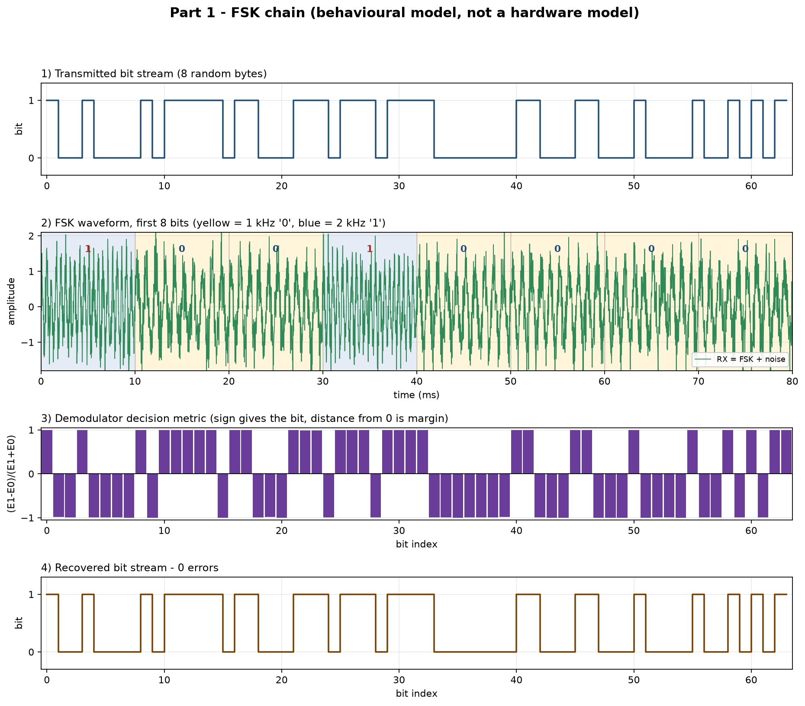
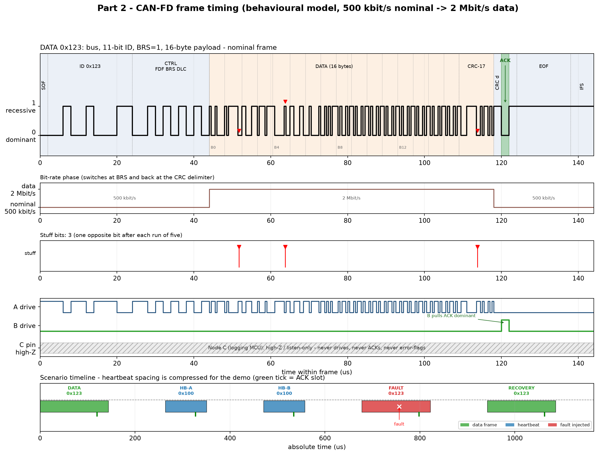
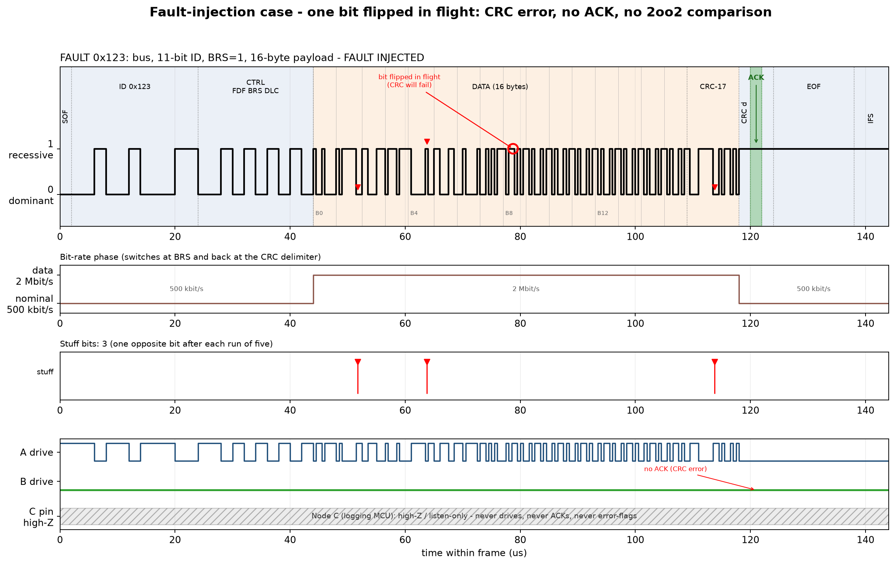

# Simulation Report — Three-Channel CAN-FD Safety Architecture

**Project:** FSK link + CAN-FD 2oo2 safety channel + listen-only logger  
**Repository:** <https://github.com/BhaveshS-001/CAN-FD> (private)  
**Final result:** **PASS** — FSK 0 bit errors, all good CAN-FD frames accepted, fault frame rejected, recovery frame accepted.

---

## 1. What the simulation does

The project is an end-to-end, **behavioural** demonstration of the three-channel safety architecture:

1. **Part 1 — FSK link.** A random 8-byte message is modulated as 1 kHz / 2 kHz FSK, transmitted through a noisy channel, demodulated, and written to `recovered.hex`.
2. **Part 2 — CAN-FD.** Those 8 bytes are padded to a 16-byte CAN-FD payload. Node A transmits the frame on a CAN-FD bus at 500 kbit/s nominal / 2 Mbit/s data rate.
3. **Node B** de-stuffs the frame, checks the CRC-17, drives the ACK slot if the CRC is good, and performs the 2oo2 payload comparison.
4. **Node C** is a passive logger: it never drives the bus, never ACKs, never flags errors, and writes a timestamped CSV row for every frame it hears.
5. **Heartbeats.** A and B exchange `0x100` heartbeat frames and cross-monitor each other.
6. **Fault injection.** One bit is flipped in flight. B and C detect the CRC error, B does not ACK, A flags the missing ACK, and the next frame recovers.

Two independent implementations are included:

| Implementation | Role |
|---|---|
| `canfd_model.py` | Python reference model; generates the PNG diagrams, CSV log, and the frame memory consumed by Verilog |
| `canfd_nodes.v` + `canfd_tb.v` | Verilog behavioural transmitter/listener/testbench; produces a GTKWave VCD and a second CSV log |

Both implementations agree on the protocol results.

> **Important scope note:** this is a **behavioural protocol model**, not a cycle-accurate model of the RM46, the S32, the CAN transceiver, or IEEE 1588. It demonstrates the frame logic and the safety behaviour, not hardware timing sign-off. The simplifications are listed in Section 10.

---

## 2. Architecture and signal flow

```text
  8 random bytes
        |
        v
  +-----+------------------+
  |  FSK modulator          |   1 kHz = '0', 2 kHz = '1'
  |  (Part 1)               |
  +-----+------------------+
        |  noisy FSK waveform
        v
  +-----+------------------+
  |  FSK demodulator        |   non-coherent energy detector
  +-----+------------------+
        |  8 recovered bytes -> recovered.hex
        v
  +-----+------------------+         CAN-FD bus          +----------------------+
  |  Node A — RM46          |  SOF/ID/CTRL/DATA/CRC/...  |  Node B — S32        |
  |  transmitter + monitor  | -------------------------> |  receiver + ACK      |
  |  (safety channel A)     | <------------------------- |  2oo2 compare        |
  +-------------------------+         ACK / heartbeat    |  (safety channel B)  |
                                                          +----------+-----------+
                                                                     |
                                                                     | listen-only
                                                                     v
                                                          +----------+-----------+
                                                          |  Node C — S32        |
                                                          |  passive logger      |
                                                          |  high-Z pin, CSV     |
                                                          +----------------------+
```

### 2.1 Channel roles

| Channel | Hardware in the architecture | Behaviour modelled here |
|---|---|---|
| **A** | TI Hercules RM46 (lockstep Cortex-R4F) | Transmits data frames and heartbeats; monitors the ACK slot; ACKs B's heartbeat |
| **B** | NXP S32 safety MCU | Receives A's frames; de-stuffs; CRC check; drives ACK; 2oo2 compare; sends its own heartbeat; ACKs A's frames |
| **C** | Independent NXP S32 logging MCU | Listens only; never drives, never ACKs, never error-flags; logs `timestamp_us,id,brs,dlc,payload_hex,crc_ok,ack_seen` |

The important safety property demonstrated by the model is:

- A and B participate in the safety exchange (transmit, receive, ACK, compare).
- C can observe everything but **cannot influence** the bus. In the Verilog model, C's pin is literally `1'bz` and is not included in the bus-drive equation.

### 2.2 What "2oo2" means in this model

In a full 2oo2 system, two independent processing channels compute the same result and compare their outputs. Here the comparison is modelled at the bus level:

- A transmits the 16-byte payload.
- B has its own expected copy of that payload (`EXPECTED_PAYLOAD` in Verilog, the original payload in Python).
- B compares the received 16 bytes with its own copy.
- If the CRC is good and the bytes match, B reports **MATCH**.
- If the CRC fails, the frame is **rejected before the comparison**, so a corrupted frame cannot produce a false MATCH.

This is a protocol-level 2oo2 demonstration, not a simulation of the internal lockstep/voting logic of the two MCUs.

---

## 3. Part 1 — FSK chain

### 3.1 Configuration

| Parameter | Value |
|---|---|
| Sample rate `fs` | 48,000 Hz |
| Bit rate | 100 bit/s |
| Samples per bit | 480 |
| Frequency for bit `0` | 1,000 Hz (10 cycles/bit) |
| Frequency for bit `1` | 2,000 Hz (20 cycles/bit) |
| Message length | 8 bytes = 64 bits |
| Noise | Additive white Gaussian noise, σ = 0.45 |
| Random seed | 2026 (repeatable demo) |
| Output | `recovered.hex` |

### 3.2 Transmitter

The transmitter builds a frequency array by repeating the tone for each bit:

```text
bit = 0  ->  1 kHz
bit = 1  ->  2 kHz
```

It then integrates the frequency to get a **continuous phase** and takes the sine:

```text
phase[n] = 2π · cumsum(freq[n]) / fs
tx[n]    = sin(phase[n])
```

The cumulative phase is important: it avoids phase jumps at bit boundaries, so the waveform looks like a real continuous-phase FSK signal rather than a sequence of unrelated sine bursts.

### 3.3 Channel

White Gaussian noise is added:

```text
rx[n] = tx[n] + N(0, σ²),   σ = 0.45
```

The signal amplitude is 1.0, so this is a deliberately noisy channel, but the detector integrates over 480 samples per bit. That gives a large processing gain (roughly `10·log10(480) ≈ 27 dB`), which is why the decision margin stays large.

### 3.4 Receiver

For every 480-sample bit window, the receiver correlates the received samples against two complex exponentials:

```text
ref0[n] = exp(-j·2π·1000·n/fs)
ref1[n] = exp(-j·2π·2000·n/fs)

E0 = |Σ rx[n]·ref0[n]|²
E1 = |Σ rx[n]·ref1[n]|²
```

It chooses the larger energy:

```text
bit = 1 if E1 > E0 else 0
```

The decision metric is:

```text
metric = (E1 − E0) / (E1 + E0)
```

- Positive metric → bit `1`
- Negative metric → bit `0`
- Distance from zero → confidence/margin

This is a non-coherent energy detector. It is equivalent in spirit to two band-pass filters followed by envelope detectors, but implemented directly with correlations and no external DSP library.

### 3.5 Result

```text
bit errors       : 0
BER              : 0.000e+00
bytes transmitted: 90 BE C7 77 80 C6 21 2B
bytes recovered  : 90 BE C7 77 80 C6 21 2B
recovered.hex    : 90BEC77780C6212B
```

The recovered bytes become the first 8 bytes of the CAN-FD payload. The remaining 8 bytes are padding (`0xA5`), giving the required 16-byte CAN-FD payload.

### 3.6 How to read `out/fsk_demo.png`



The figure has four panels:

1. **Transmitted bit stream (8 random bytes).**  
   A 64-bit step waveform. The first byte is `0x90`, so the first eight bits are
   `1 0 0 1 0 0 0 0`. This is the reference pattern that the receiver must
   recover.

2. **FSK waveform, first 8 bits.**  
   The x axis is time in milliseconds (10 ms per bit at 100 bit/s). The
   background is **yellow for a `0`** (1 kHz) and **blue for a `1`** (2 kHz).
   The green trace is the received signal, `FSK + noise`.
   - In yellow regions the oscillations are wider: 10 cycles per bit.
   - In blue regions they are denser: 20 cycles per bit.
   - The bit values are printed above each 10 ms window.
   - The noise is visible as small wiggles on the green trace, but the tone
     is still obvious.

3. **Demodulator decision metric.**  
   One bar per bit: `(E1 − E0)/(E1 + E0)`.
   - Positive bar → decided `1`
   - Negative bar → decided `0`
   - The bars are close to ±1, which means the detector has a large margin.
   - No bar is near zero, so no bit is ambiguous.

4. **Recovered bit stream.**  
   The brown step waveform should look identical to panel 1. The title says
   **0 errors**, and there are no red error markers.

The figure therefore proves three things at once:

- the modulator produced distinguishable 1 kHz and 2 kHz tones,
- the correlator-based detector separated them cleanly despite the noise,
- and the recovered 64 bits are bit-for-bit identical to the transmitted
  pattern, which is why `recovered.hex` can be used directly as the CAN-FD
  payload.

---

## 4. Part 2 — CAN-FD frame model

### 4.1 Frame fields and bit order

A standard 11-bit-ID CAN-FD data frame is built in this order:

| Field | Bits | Bit rate | Value in the normal data frame |
|---|---:|---|---|
| SOF | 1 | nominal | `0` (dominant) |
| ID | 11 | nominal | `0x123` (MSB first) |
| RRS | 1 | nominal | `0` |
| IDE | 1 | nominal | `0` (11-bit ID) |
| FDF | 1 | nominal | `1` (CAN-FD) |
| res | 1 | nominal | `0` |
| BRS | 1 | nominal | `1` (bit-rate switch) |
| ESI | 1 | nominal | `0` (error state indicator, recessive = OK) |
| DLC | 4 | nominal | `10` → **16 bytes** |
| DATA | 128 | data | 16 payload bytes |
| CRC | 17 | data | CRC-17 sequence |
| CRC delimiter | 1 | nominal | `1` |
| ACK slot | 1 | nominal | `1` from A; B pulls `0` if CRC OK |
| ACK delimiter | 1 | nominal | `1` |
| EOF | 7 | nominal | `1` |
| IFS | 3 | nominal | `1` |

The total before stuffing is 180 bits. Three stuff bits are inserted for this payload, giving **183 wire bits** for the 16-byte data frame.

**DLC note:** CAN-FD does not encode DLC as a direct byte count above 8. The mapping used is the standard one:

```text
DLC 9 -> 12 bytes
DLC 10 -> 16 bytes
DLC 11 -> 20 bytes
DLC 12 -> 24 bytes
DLC 13 -> 32 bytes
DLC 14 -> 48 bytes
DLC 15 -> 64 bytes
```

So `DLC=10` means **16 bytes**, not 10 bytes. This is visible in the console output as `DLC=10 (16B)`.

### 4.2 Bit timing and the BRS switch

| Phase | Rate | Bit time | Where |
|---|---|---|---|
| Nominal / arbitration | 500 kbit/s | 2,000 ns | SOF through the BRS bit |
| Data | 2 Mbit/s | 500 ns | After BRS through the last CRC bit |
| Nominal / trailer | 500 kbit/s | 2,000 ns | CRC delimiter through IFS |

The BRS bit itself is transmitted at the nominal rate. The **next** bit (the first data bit) is at 2 Mbit/s. The rate returns to nominal at the **CRC delimiter**, which is the first trailer bit after the CRC sequence.

In the timing diagram this is visible in two ways:

- The bit widths in the bus waveform shrink by 4× inside the data region.
- The separate "bit-rate phase" row steps from `nominal 500 kbit/s` to `data 2 Mbit/s` and back.

### 4.3 Bit stuffing

Stuffing is applied from SOF through the CRC sequence:

- After **five equal consecutive bits**, insert one bit of the opposite value.
- The receiver removes stuff bits using the same rule.
- If the receiver sees a sixth equal bit where a stuff bit should be, it raises a stuff error.
- A possible stuff bit immediately after the **last CRC bit** is also inserted and removed consistently (handled by `finish_stuff` in Python and state 6 in the Verilog listener).

For the 16-byte frame, the diagram marks **3 stuff bits**. They appear as red triangles in the stuff row and on the bus row.

### 4.4 CRC-17

The CRC is the CAN-FD CRC-17 with polynomial `0x1685B`, MSB-first:

```text
crc ^= bit << 16
if crc & 0x10000:
    crc = ((crc << 1) ^ 0x1685B) & 0x1FFFF
else:
    crc = (crc << 1) & 0x1FFFF
```

The message bits (SOF through DATA) are processed first, then **17 zero bits** are appended. The final 17-bit register is the CRC sequence sent on the wire.

The receiver can check it in two equivalent ways:

- Recompute the CRC over the de-stuffed message and compare it with the received 17 bits.
- Feed the received bits through the same LFSR and check the final residue.

The Python model uses the first method; the Verilog listener feeds zeros during the 17 CRC bit times and compares the final register to the received CRC. Both produce the same result.

### 4.5 ACK

The ACK slot is an open-drain / wired-AND slot:

- The transmitter sends the slot **recessive** (`1`).
- If a receiver has a good CRC, it pulls the slot **dominant** (`0`).
- The transmitter samples the slot: `0` means ACK seen, `1` means no ACK (ACK error).
- A second receiver must not drive the slot dominant while another receiver is already driving it; in this model only the intended receiver ACKs each frame.
- Node C never drives the ACK slot.

In the normal frame, B pulls the ACK slot dominant. In the fault frame, B's CRC check fails, so B leaves the slot recessive and A raises its ACK-error flag.

### 4.6 2oo2 comparison

For every data frame, B compares the received 16-byte payload with its own expected copy.

- CRC good + bytes equal → **MATCH**
- CRC good + bytes different → **MISMATCH**
- CRC bad → frame **rejected before comparison** (no false MATCH)

The fault frame is therefore reported as "rejected (CRC error)" rather than "MISMATCH", because the CRC failure is detected first.

### 4.7 Heartbeats

Two heartbeat frames use ID `0x100`:

| Frame | Source | Payload byte | Purpose |
|---|---|---|---|
| HB-A | A | `0xA1` | B checks that A is alive and its heartbeat is intact |
| HB-B | B | `0xB2` | A checks that B is alive and its heartbeat is intact |

A and B also ACK each other's heartbeats, so the logger sees `ack_seen=1` on both heartbeat rows. The heartbeat interval is compressed for the demo (120 µs in Python, 100 µs in Verilog); a real system would use milliseconds.

### 4.8 Node C logger

C runs the same de-stuffing and CRC logic as B, but:

- `DO_ACK=0` — it never drives the ACK slot.
- Its pin is `1'bz` in the Verilog testbench and is **not** in the bus equation.
- It writes one CSV row per frame.

CSV columns:

```text
timestamp_us,id,brs,dlc,payload_hex,crc_ok,ack_seen
```

- `timestamp_us` — frame start time
- `id` — decoded 11-bit identifier
- `brs` — bit-rate-switch flag (`1` for these frames)
- `dlc` — raw DLC code (`10` = 16 bytes, `1` = 1 byte)
- `payload_hex` — decoded payload bytes
- `crc_ok` — `1` if the CRC check passed
- `ack_seen` — `1` if the ACK slot was dominant

### 4.9 Scenario schedule

The Python model runs five frames with 120 µs gaps:

| # | Frame | ID | DLC | Payload | Start time | Expected result |
|---:|---|---:|---:|---|---:|---|
| 0 | DATA | `0x123` | 10 | 16 bytes | 0.000 µs | CRC OK, ACK, 2oo2 MATCH |
| 1 | HB-A | `0x100` | 1 | `A1` | 264.000 µs | CRC OK, cross-monitor OK |
| 2 | HB-B | `0x100` | 1 | `B2` | 471.000 µs | CRC OK, cross-monitor OK |
| 3 | FAULT | `0x123` | 10 | 16 bytes, 1 bit flipped | 678.000 µs | CRC ERROR, no ACK, rejected |
| 4 | RECOVERY | `0x123` | 10 | 16 bytes | 942.000 µs | CRC OK, ACK, 2oo2 MATCH |

The Verilog model uses 100 µs gaps, so its CSV timestamps are different, but the sequence and results are identical.

### 4.10 Fault injection

The Python model searches for a bit that:

- is in the DATA or CRC field,
- is **not** a stuff bit,
- when flipped, still leaves the receiver structurally aligned (no stuff error, no delimiter/EOF error),
- and produces a **CRC error**.

The selected bit is **wire index 91**. It falls in the 9th payload byte (byte index 8), flipping that byte from `A5` to `B5`:

```text
expected:  90 BE C7 77 80 C6 21 2B A5 A5 A5 A5 A5 A5 A5 A5
corrupted: 90 BE C7 77 80 C6 21 2B B5 A5 A5 A5 A5 A5 A5 A5
```

Consequences:

- B's CRC check fails.
- C's CRC check fails.
- B does not drive the ACK slot.
- A samples a recessive ACK slot and sets its ACK-error flag.
- The frame is not compared, so there is no false MATCH.
- The next frame (RECOVERY) is clean and is accepted again.

---

## 5. How to read `out/timing_diagram.png`



This figure shows the normal DATA frame in detail, plus the whole five-frame scenario.

### Row 1 — bus waveform and fields

- **Y axis:** `0 dominant` and `1 recessive`. CAN buses are dominant-low in this model.
- **Background colors:** light blue = nominal 500 kbit/s phase; light orange = data 2 Mbit/s phase.
- **Black waveform:** the actual bus level. In the data region the pulses are visibly narrower because each bit is 500 ns instead of 2,000 ns.
- **Dotted vertical lines and labels:** field boundaries:
  - `SOF` — start of frame
  - `ID 0x123` — 11-bit identifier
  - `CTRL FDF BRS DLC` — control field (the label is simplified; it covers RRS, IDE, FDF, res, BRS, ESI, DLC)
  - `DATA (16 bytes)` — payload
  - `CRC-17` — CRC sequence
  - `CRC d` — CRC delimiter (rotated label)
  - `ACK` — green arrow pointing at the ACK slot
  - `EOF` — end-of-frame
  - `IFS` — inter-frame space
- **Byte grid labels `B0`, `B4`, `B8`, `B12`:** mark every 4th payload byte (32 bits).
- **Red triangles on the bus / stuff row:** stuff bits, not errors. There are three, one after each run of five equal bits.
- **Green vertical band around 120 µs:** the ACK slot. The bus goes dominant here because B is pulling it low.

### Row 2 — bit-rate phase

- Starts at `nominal 500 kbit/s`.
- Steps up to `data 2 Mbit/s` at the start of the data field (after the BRS bit), around 44 µs.
- Steps back to `nominal 500 kbit/s` at the CRC delimiter, around 118–119 µs.
- This row is the visual proof that the BRS switch is implemented and that the CRC delimiter returns the frame to the nominal rate.

### Row 3 — stuff bits

- Three red downward markers at roughly 51 µs, 65 µs, and 115 µs.
- Each marker corresponds to one inserted opposite bit after a run of five equal bits.
- The receiver removes these bits before decoding, so the de-stuffed frame has the original 180 message bits.

### Row 4 — drive ownership

- **A drive (blue):** goes high/low as A transmits dominant/recessive bits. A is the transmitter for this frame.
- **B drive (green):** flat except for a single short pulse at the ACK slot. The annotation "B pulls ACK dominant" points at it.
- **C pin high-Z (gray hatched band):** C is listening only. It never drives, never ACKs, never flags errors.

This row is the key safety visual: B drives only the ACK slot, and C drives nothing at all.

### Row 5 — scenario timeline

This is the whole demo on an absolute time axis:

- **DATA 0x123** (green, 0–144 µs)
- **HB-A 0x100** (blue, 264–351 µs)
- **HB-B 0x100** (blue, 471–558 µs)
- **FAULT 0x123** (red, 678–822 µs) with a white `×` at the fault bit and a red "fault" label
- **RECOVERY 0x123** (green, 942–1086 µs)

The green tick under each bar marks the ACK slot. The dashed horizontal line is only a visual baseline. The legend in the lower right identifies data frames, heartbeats, and the fault-injected frame.

### What this diagram proves

1. The frame has the expected CAN-FD fields and bit order.
2. The BRS switch is present: nominal → data → nominal.
3. Bit stuffing is present and is removed consistently.
4. B ACKs a good frame; A drives the data bits; C is completely passive.
5. The scenario runs data → heartbeat → heartbeat → fault → recovery, and the recovery frame is clean.

---

## 6. How to read `out/fault_timing.png`



This figure uses the same four detail rows for the FAULT frame. The differences are the important part.

### Row 1 — the flipped bit

- A red circle at about 79 µs marks the bit that was flipped in flight.
- The red arrow annotation says "bit flipped in flight (CRC will fail)".
- The flip is inside the DATA field, at wire index 91. The payload byte changes from `A5` to `B5`.
- The rest of the frame is structurally valid: no stuff error, no delimiter error, no EOF error. This is why the receiver can still parse the frame and isolate the failure to the CRC.

### Row 2 — phase

- Unchanged: nominal → data → nominal.
- The rate switch and the trailer are not affected by the bit flip.

### Row 3 — stuff bits

- Still three stuff bits.
- The fault bit is deliberately **not** a stuff bit, so the de-stuffing alignment remains correct.

### Row 4 — drive ownership and ACK

- **A drive (blue):** still toggles normally; A does not know the bit was corrupted in flight.
- **B drive (green):** flat. There is no ACK pulse. The red annotation "no ACK (CRC error)" points at the ACK slot.
- **C pin high-Z (gray hatched):** unchanged; C only observes and logs.
- The ACK slot is still shaded green because it is still the ACK opportunity, but the bus remains recessive because nobody drives it.

### What this diagram proves

1. A single in-flight bit flip is enough to break the CRC.
2. B detects the failure and refuses to ACK.
3. C also sees the CRC failure but remains passive.
4. A sees a missing ACK and can flag the frame as failed.
5. The frame is rejected before the 2oo2 comparison, so corruption cannot produce a false MATCH.
6. The next frame recovers, showing that the fault is transient and the channel is not permanently damaged.

---

## 7. Verilog model and VCD

### 7.1 Modules

| Module | Purpose |
|---|---|
| `canfd_tx` | Reads `out/frames.mem`; emits the bit value, bit timing, sample strobe, and ACK-slot sampling |
| `canfd_listener` | Parameterised receiver (`NODE`, `DO_ACK`, `DO_CSV`); de-stuffs, decodes fields, checks CRC, drives ACK, compares payload, logs CSV |
| `canfd_tb` | Top level: 100 MHz clock, reset, open-drain bus, fault override, scheduler, VCD dump, console summary |

### 7.2 Bus model

The bus is an open-drain wired-AND:

```verilog
wire fault_apply = fault_en && a_active && (a_bit_idx == FAULT_BIT);
wire a_dom_eff   = fault_apply ? 1'b0 : a_dom;
wire fault_dom   = fault_apply ? ~a_dom : 1'b0;
wire bus = ~(a_dom_eff | b_tx_dom | a_ack_dom | b_ack_dom | fault_dom);

wire c_pin = 1'bz;   // logger pin: high-Z forever
```

- `a_dom` / `b_tx_dom`: transmitter dominant drives.
- `a_ack_dom` / `b_ack_dom`: ACK drives from the listeners.
- `fault_dom`: when the fault is active, A's normal drive is masked and the **complement** is driven, which is exactly the in-flight bit flip.
- `c_pin` is **not** in the bus equation. C cannot affect the bus even if its internal logic were wrong.

### 7.3 Listener state machine

The listener uses the shared bit-timing strobes from the testbench:

| State | Meaning |
|---|---|
| 0 | SOF through the last CRC bit; de-stuff after five equal bits; compute CRC |
| 6 | Optional final stuff bit immediately after the last CRC bit |
| 1 | CRC delimiter |
| 2 | ACK slot sample |
| 3 | ACK delimiter |
| 4 | EOF (7 recessive bits) |
| 5 | IFS (3 recessive bits); then `frame_done` |

At `frame_done`, the listener latches:

- `crc_ok`
- `ack_seen`
- `frame_id_out`
- `brs_out`
- `dlc_out`
- `match` (ID + CRC + 16-byte compare)
- `hb_ok` (ID + CRC + expected heartbeat byte)
- `error_flag` (CRC or structural error)

### 7.4 ACK timing

The ACK drive is deliberately timed:

1. At the CRC-delimiter sample, the listener sets `ack_go`.
2. At the next `bit_start` (the ACK slot), it asserts `drive`.
3. At the ACK-slot sample, it deasserts `drive`.

This makes the ACK pulse start slightly after the slot begins and end at the sample point, so it cannot leak into the ACK delimiter. A samples the slot at mid-bit and sees the dominant level.

### 7.5 Verilog result

```text
[144.2 us] A data    0x123: B crc=1 ack=1 match=1 | C crc=1 ack=1 | A ack_seen=1 ack_err=0
[331.2 us] A HB      0x100: B crc=1 hb_ok=1 | C crc=1 ack=1
[518.3 us] B HB      0x100: A crc=1 hb_ok=1 | C crc=1 ack=1
[762.3 us] FAULT     bit 91: B crc=0 ack=0 | C crc=0 ack=0 | A ack_seen=0 ack_err=1
[1006.3 us] RECOVERY 0x123: B crc=1 ack=1 match=1 | C crc=1 ack=1
 RESULT: PASS
```

### 7.6 VCD signals

Open the waveform with:

```bat
gtkwave out\canfd_verilog.vcd
```

Useful signals:

| Signal | Meaning |
|---|---|
| `bus` | Resolved open-drain bus |
| `phase_sel` | 0 = nominal, 1 = data |
| `stuff_sel` | Stuff-bit marker |
| `a_dom` / `a_dom_eff` | A's raw drive / fault-masked drive |
| `b_tx_dom` | B's transmitter drive |
| `a_ack_dom` / `b_ack_dom` | ACK drives from A/B listeners |
| `c_pin` | Node C pin — should remain `z` |
| `fault_apply` | High only during the injected bit |
| `a_ack_seen` / `a_ack_error` | A's ACK sampling and error flag |
| `b_crc_ok` / `b_ack_seen` / `b_match` | B's results |
| `c_crc_ok` / `c_ack_seen` | C's results |

The VCD is written with a 1 ps timescale; GTKWave displays the time in µs. If the signal tree shows repeated `canfd_tb` scopes (an Icarus `$dumpvars` quirk), use GTKWave's signal search or add the named signals directly.

### 7.7 Why the Python and Verilog timestamps differ

| Model | Gap between frames | First frame start |
|---|---:|---:|
| Python | 120 µs | 0.000 µs |
| Verilog | 100 µs | 0.205 µs (after reset) |

The frame durations are the same in both models (≈144 µs for a 16-byte data frame, ≈87 µs for a 1-byte heartbeat), but the absolute timestamps differ. The important part is that the **sequence and the CRC/ACK/2oo2 results are identical**.

---

## 8. Output files and CSV logs

### 8.1 Files

| File | Contents |
|---|---|
| `recovered.hex` | 8 bytes recovered by the FSK demodulator |
| `out/fsk_demo.png` | Four-panel FSK diagram |
| `out/timing_diagram.png` | Normal frame detail + five-frame timeline |
| `out/fault_timing.png` | Fault frame detail |
| `out/canfd_log.csv` | Node C log from the Python model |
| `out/canfd_verilog_log.csv` | Node C log from the Verilog model |
| `out/canfd_verilog.vcd` | GTKWave waveform |
| `out/frames.mem` | 1024-word frame memory (padded) |
| `out/frames_def.vh` | Base/length constants, expected payload, fault index |
| `out/last_run.log` | Full local run log (not committed) |
| `out/sim.vvp` | Compiled Verilog simulation (not committed) |

### 8.2 Python C log

```csv
timestamp_us,id,brs,dlc,payload_hex,crc_ok,ack_seen
0.000,123,1,10,90BEC77780C6212BA5A5A5A5A5A5A5A5,1,1
264.000,100,1,1,A1,1,1
471.000,100,1,1,B2,1,1
678.000,123,1,10,90BEC77780C6212BB5A5A5A5A5A5A5A5,0,0
942.000,123,1,10,90BEC77780C6212BA5A5A5A5A5A5A5A5,1,1
```

Line by line:

1. **0.000 µs** — normal data frame, ID `0x123`, DLC 10 (16 bytes), correct payload, CRC OK, ACK seen.
2. **264.000 µs** — A heartbeat, ID `0x100`, DLC 1, payload `A1`, CRC OK, ACK seen.
3. **471.000 µs** — B heartbeat, ID `0x100`, DLC 1, payload `B2`, CRC OK, ACK seen.
4. **678.000 µs** — fault frame: the 9th payload byte is `B5` instead of `A5`, CRC fails, no ACK. C still logs the frame but marks it invalid.
5. **942.000 µs** — recovery frame, correct payload again, CRC OK, ACK seen.

### 8.3 Verilog C log

```csv
timestamp_us,id,brs,dlc,payload_hex,crc_ok,ack_seen
0.205,123,1,10,90bec77780c6212ba5a5a5a5a5a5a5a5,1,1
244.225,100,1,1,a1,1,1
431.245,100,1,1,b2,1,1
618.265,123,1,10,90bec77780c6212bb5a5a5a5a5a5a5a5,0,0
862.285,123,1,10,90bec77780c6212ba5a5a5a5a5a5a5a5,1,1
```

The values are the same; only the timestamps and hex letter case differ. The Verilog log is written by the `canfd_listener` instance configured as node C (`DO_CSV=1`).

### 8.4 Console summary

The runner prints:

- FSK bit errors, BER, transmitted/recovered bytes.
- CAN-FD frame table with ID, DLC, CRC, ACK, role, and 2oo2 result.
- Fault-injection description.
- Verilog result lines and `RESULT: PASS`.
- Paths to the CSV, PNG, VCD, and frame files.

---

## 9. Verification and fixes during development

The project was run end-to-end and the following issues were found and fixed:

1. **Verilog start-signal race.** The testbench initially deasserted `start` in the same simulation delta as the rising clock edge, so the transmitter could miss the start pulse and the scheduler would wait forever. Fixed by holding `start` for 1 ns after the edge before deasserting it.
2. **OneDrive PNG write lock.** Saving a PNG could intermittently fail with `OSError: [Errno 22]` while OneDrive or an image viewer held the file. Added a retry loop around `savefig` in both Python scripts.
3. **`$readmemh` warning.** The frame memory is now padded to 1024 words, so Icarus does not warn about a short file.
4. **Plot labels.** The ACK-slot label was moved to an arrow and the ACK-delimiter label was blanked to avoid collisions in the narrow trailer region.

Cross-checks performed:

- FSK transmitted and recovered bytes match exactly; 0 bit errors.
- The fault frame's payload differs from the expected payload by exactly one bit (`A5` → `B5`).
- B and C both report `crc_ok=0` for the fault frame.
- B does not ACK the fault frame; A reports `ack_err=1`.
- The recovery frame returns to `crc_ok=1`, `ack_seen=1`, `match=1`.
- The Python and Verilog logs agree on all frame results.

---

## 10. Simplifications and limitations

These are deliberate, and they are stated in the source comments and README:

1. **Behavioural, not cycle-accurate.** No RM46/S32 peripheral registers, no CAN transceiver analogue behaviour, no oscillator tolerance, no bit resynchronisation.
2. **Shared bit timing.** All Verilog nodes use the testbench bit-timing strobes. A real CAN controller recovers the bit clock from the bus edges.
3. **Compressed heartbeat interval.** 100–120 µs instead of milliseconds, so the whole scenario fits on one readable plot.
4. **One injected bit flip.** The fault is a demonstration hook, not a physical fault injector. The bit is chosen to preserve frame alignment and produce a clean CRC error.
5. **Simplified CRC-field stuffing.** The CAN-FD stuff-count field and the fixed stuff bits inside the CRC field are not modelled beyond the normal "five equal bits" rule. The assignment explicitly allows this simplification.
6. **PTP/IEEE 1588 is not modelled.** The logger timestamp is the simulation time. The architecture's PTP timestamping and eMMC/FRAM storage are outside the scope of this model.
7. **2oo2 is modelled at the bus level.** B compares the received payload with its own expected copy. The internal lockstep/voting of the two MCUs is not simulated.
8. **No bus arbitration or error frames.** The scenario is a scheduled demo with one transmitter at a time. Arbitration, error frames, and bus-off recovery are not modelled.

A real system would add:

- independent bit-rate recovery and resynchronisation,
- transceiver delays and loop delays,
- clock tolerance and worst-case bit timing,
- CAN error frames and bus-off handling,
- a real PTP time base for the logger,
- physical fault injection (e.g., a forced dominant bit or a transceiver fault).

---

## 11. How to reproduce

### One command

```bat
run_all.bat
```

or without the final pause:

```bat
run_all.bat --no-pause
```

Git Bash / Linux / macOS:

```bash
bash run_all.sh
```

### Individual steps

```bat
python fsk_chain.py
python canfd_model.py
iverilog -g2012 -o out\sim.vvp canfd_nodes.v canfd_tb.v
vvp out\sim.vvp
gtkwave out\canfd_verilog.vcd
```

Run the Verilog commands from the project root: the testbench reads `out/frames.mem` and writes `out/canfd_verilog.vcd` using relative paths.

### Five-line demo script

1. "The FSK modem converts an 8-byte random pattern into 1 kHz / 2 kHz tones; the receiver recovers all 64 bits with zero errors."
2. "Those bytes are padded to a 16-byte CAN-FD payload and Node A sends it with an 11-bit ID, BRS=1, 500 kbit/s arbitration and 2 Mbit/s data, CRC-17 and bit stuffing."
3. "Node B removes the stuff bits, checks the CRC, pulls the ACK slot dominant and compares the payload with its own copy — the 2oo2 result is MATCH."
4. "Node C is completely passive: its pin stays high-Z, it never drives or ACKs, and it writes a timestamped CSV row for every frame it hears."
5. "In the fault test we flip one bit in flight: B and C both detect the CRC error, B does not ACK, A flags the missing ACK, and the next frame recovers."

---

## 12. Conclusion

The simulation demonstrates the complete intended chain:

- a noisy FSK link that recovers 64 bits with **zero errors**,
- a CAN-FD frame with correct 11-bit ID, BRS switching, 16-byte DLC encoding, CRC-17, bit stuffing, ACK, and trailer,
- a 2oo2 payload comparison at Node B,
- a listen-only logger at Node C that never influences the bus,
- heartbeat cross-monitoring between A and B,
- and a fault-injection/recovery sequence in which a single bit flip is detected by both receivers, ACK is withheld, and the next frame is accepted.

The Python and Verilog models independently produce the same protocol results, which is the main validation of the implementation.

**Final result: PASS.**
